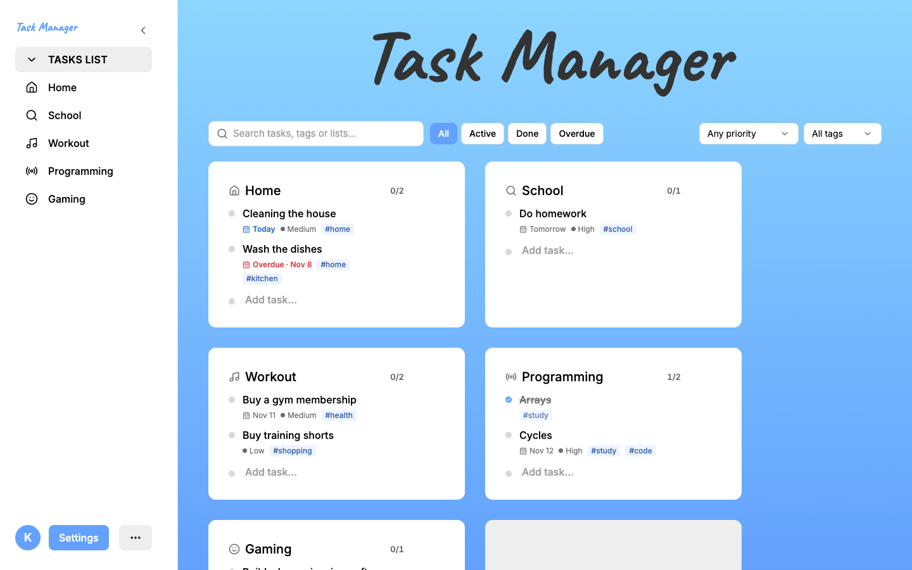
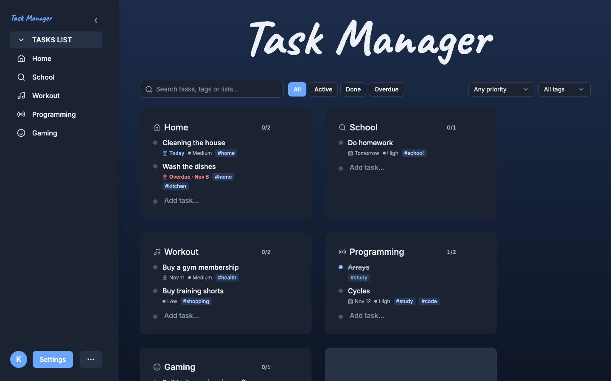
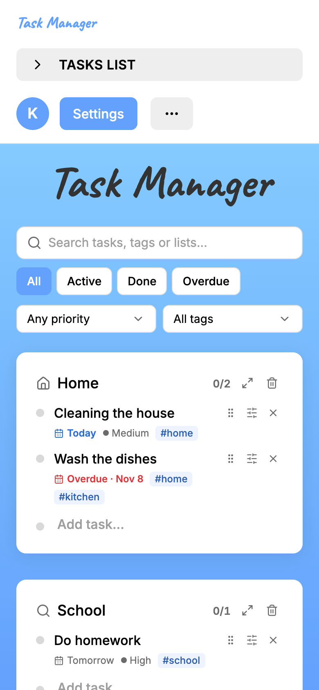

# Task Manager

Планировщик задач со списками, дедлайнами, приоритетами, тегами, поиском и drag & drop. Интерфейс собран по макету из Figma, логика — на React, данные хранятся в браузере.



## Возможности

- **Вход по email** с валидацией — сессия сохраняется между перезагрузками.
- **Списки**: создание через «+ Add list...», переименование по клику на заголовок, удаление с подтверждением, выбор иконки.
- **Задачи**: добавление по Enter, редактирование по клику на текст (Enter — сохранить, Esc — отменить), удаление с отменой (Undo, 6 секунд).
- **Дедлайны**: дата в карточке задачи, подписи Today / Tomorrow, просроченные выделяются красным, отдельный фильтр Overdue.
- **Приоритеты**: Low / Medium / High, цветной индикатор в задаче и фильтр по приоритету.
- **Теги**: до 6 тегов на задачу, чипы в строке задачи и фильтр по тегу.
- **Поиск и фильтры**: поиск по тексту задач, тегам и названиям списков + фильтры по статусу, приоритету и тегу; пустое состояние с кнопкой сброса.
- **Drag & drop**: перетаскивание задач внутри списка и между списками (мышью и с клавиатуры).
- **Прогресс** `выполнено/всего` в шапке каждой карточки и счётчик в детальном режиме списка.
- **Тёмная тема**: переключатель в Settings, по умолчанию — системная тема; выбор сохраняется.
- **Сайдбар**: сворачивание, клик по списку прокручивает к карточке и подсвечивает её; меню «...» сбрасывает данные к демо-набору.
- **Сохранение в `localStorage`** с валидацией: повреждённое хранилище не ломает приложение, данные старых версий мигрируют автоматически.
- **Клавиатура и скринридеры**: focus trap в диалогах, закрытие по Esc, видимый фокус, aria-атрибуты.
- **Адаптив**: на мобильных карточки в одну колонку, меню списков свёрнуто, действия с задачами всегда видны.
- Учитывается `prefers-reduced-motion`.

<p align="center">
  
  
</p>

## Стек

- React 18 + Vite 5
- `@dnd-kit` — drag & drop с поддержкой клавиатуры
- lucide-react — иконки
- Чистый CSS с переменными тем (светлая/тёмная), значения из макета Figma
- localStorage — данные сохраняются между сессиями
- Без бэкенда и авторизации

## Запуск

Нужен Node.js 18+.

```bash
npm install
npm run dev
```

Приложение откроется на http://localhost:5173.

Сборка и предпросмотр:

```bash
npm run build
npm run preview
```

## Как пользоваться

- **Редактировать текст задачи** — клик по тексту; Enter сохраняет, Esc отменяет.
- **Дедлайн, приоритет и теги** — иконка ползунков справа от задачи.
- **Переставить задачу** — потянуть за иконку из шести точек. Клавиатура: сфокусировать ручку, Space — взять, стрелки — двигать, Space — отпустить. Перетаскивание работает, когда фильтры выключены.
- **Тема** — Settings → Dark theme / Light theme.
- **Сброс** — «...» → Reset demo data (с подтверждением).

## Структура

```
.
├── index.html
├── public/
│   └── favicon.svg
├── src/
│   ├── App.jsx      # состояние, экраны и компоненты
│   ├── index.css    # стили, темы и адаптив
│   └── main.jsx     # точка входа
├── docs/            # скриншоты
└── vite.config.js
```

## Данные

Состояние лежит в `localStorage` под ключом `task-manager-app-v1`:

```json
{
  "version": 3,
  "user": "you@example.com",
  "theme": "light",
  "lists": [
    {
      "id": "…",
      "title": "Home",
      "icon": "home",
      "tasks": [
        {
          "id": "…",
          "text": "Wash the dishes",
          "done": false,
          "due": "2026-11-09",
          "priority": "medium",
          "tags": ["home", "kitchen"]
        }
      ]
    }
  ]
}
```

При загрузке данные валидируются: битые записи, пустые задачи и некорректные даты отбрасываются; данные первой и второй версий (без `theme`, `due`, `priority`, `tags`) читаются автоматически. Полный сброс — очистить localStorage для сайта или «...» → Reset demo data.

## Ограничения

- Авторизация демонстрационная: email хранится локально, OAuth и пароля нет.
- Нет бэкенда и синхронизации между устройствами.
- Дедлайны без времени и без напоминаний.
- Нет автотестов — поведение проверялось вручную в Chromium.

## Идеи для следующего шага

Подзадачи, повторяющиеся задачи, напоминания, поиск по архиву, синхронизация с бэкендом, автотесты (Vitest + Playwright).
